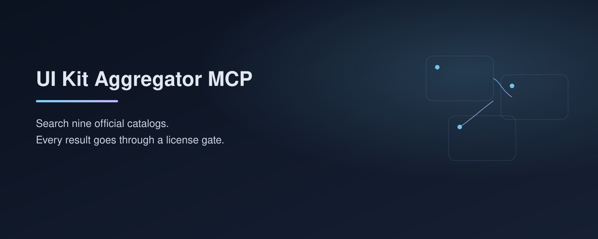
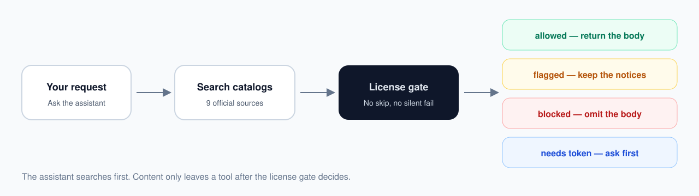

<p align="center">
  
</p>

<h4 align="center">
  <a href="#為什麼要做這個">為什麼做這個</a> |
  <a href="#特色">特色</a> |
  <a href="#八個來源">來源</a> |
  <a href="#許可證門禁">門禁</a> |
  <a href="#快速開始">快速開始</a>
</h4>

<div align="center">
  <h2>
    給 AI 程式設計助手用的 UI／動效目錄聚合服務。<br />
    搜尋 8 個官方來源，每一條都先過許可證門禁再交給助手。
  </h2>
</div>

<p align="center">
  <a href="LICENSE"></a>
  
  
</p>

<div align="center">
  <figure>
    
    <figcaption>
      <p align="center">先搜尋，再過門禁，最後才把允許的內容交給助手。</p>
    </figcaption>
  </figure>
</div>

## 為什麼要做這個

用 AI 做網站時，常常需要現成的按鈕、版面、文字動畫或整頁設計提示。這些材料已經存在，只是分散在不同官方目錄裡，授權條件也不一樣。

如果助手略過這些差異，就可能用錯授權、取到不該取的付費內容，或在授權不明時仍然把原始碼帶出來。這個服務把「搜尋」和「許可證檢查」做成同一條路：先搜，再決定可不可以取用。沒有付費金鑰時，免費目錄仍可正常使用。

本專案不擁有這 8 個目錄，只從官方介面取內容，不會把整庫鏡像下來。

## 特色

- 🔍　一次搜尋 8 個官方 UI／動效目錄
- 🚪　同一套許可證門禁，沒有跳過檢查的參數
- 🆓　沒有金鑰也能使用免費目錄
- 🔑　遇到付費內容會先詢問，不會默默失敗或偷偷略過
- 📦　回傳官方安裝方式、文件摘錄或可用原始碼
- ⚖️　會區分最終產品使用與再分發

## 八個來源

- **MotionSites**：概念站整頁設計提示詞。本服務只提供官方入口，不返回鎖定的提示詞正文。
- **React Bits**：可複製貼上的 React 動畫元件。免費目錄為 MIT + Commons Clause；Pro 需要 `REACTBITS_LICENSE_KEY`。
- **Uiverse**：社群 HTML、CSS、Tailwind 和 React 小部件，許可證一般為 MIT。
- **Anime.js**：輕量 JavaScript 動畫引擎及其官方文件，許可證為 MIT。
- **Aceternity UI**：偏進階視覺效果的 React 與 Tailwind 元件。免費目錄可直接取用；All-Access 需要 `ACETERNITY_PRO_TOKEN`。
- **Motion Prompt**：動畫、鏡頭運動與頁面轉場的提示詞庫，許可證為 MIT。
- **Cult UI**：官方 registry 中的 React／shadcn 風格元件，許可證為 MIT。
- **Magic UI**：官方免費／MIT 目錄中的動畫元件。Magic UI Pro 不是本服務的來源，會被直接攔截。

## 提供哪些工具

- `list_sources`：列出全部來源、專長、許可證摘要，以及需要哪些環境變數。
- `search_ui_kits`：在全部或指定來源中搜尋。這是最常用的入口。
- `get_item`：取選定項目的文件摘錄、官方示例或元件原始碼。
- `get_license`：只查看條款、署名和聲明文本。
- `check_compliance`：檢查擬定用途是否合規，例如用在客戶行銷網站，或再發佈成元件庫。

典型流程是：你向助手描述需要什麼，助手用 `search_ui_kits` 搜尋，再對選定的那一條呼叫 `get_item`。

## 許可證門禁

每一條內容都必須經過門禁，才能帶正文離開工具。

- `allowed`：許可證明確且用途允許，返回正文。
- `flagged`：還有額外義務（例如第三方字體聲明）。正文仍可返回，原聲明必須保留。
- `blocked`：攔截並省略正文，只保留原因和條款連結。
- `needs_token`：缺少所需金鑰。助手會問你要設定金鑰還是跳過，不會在工具呼叫裡收集金鑰。

官方註冊／取得金鑰：

- Aceternity All-Access：[定價](https://ui.aceternity.com/pricing)、[Pro](https://ui.aceternity.com/pro)、[金鑰頁](https://ui.aceternity.com/dashboard/token)
- React Bits Pro：[Pro](https://www.reactbits.dev/pro)、[安裝說明](https://pro.reactbits.dev/docs/installation)

以下情況一律是 `blocked`，不會改成「要不要加金鑰」：許可證無法確定、MotionSites 的提示詞正文、Magic UI Pro，以及不允許的再分發（例如把元件再發佈成元件庫，或出售模板包）。

「用在客戶行銷網站」一般視為最終產品，通常可以；「再發佈為元件庫」或「出售模板包」屬於再分發，會被攔截。

## 快速開始

需要 Node.js 20 或更新版本。

```bash
git clone https://github.com/Faixiang/UI-Kit-Aggregator-MCP
cd UI-Kit-Aggregator-MCP
npm install
npm start
```

預設透過標準輸入輸出（stdio）提供服務。在 Cursor 的 MCP 設定（專案內常見為 `.cursor/mcp.json`）或 Claude Code 的 `.mcp.json` 中加入：

```json
{
  "mcpServers": {
    "ui-kit-aggregator": {
      "command": "node",
      "args": ["dist/index.js"]
    }
  }
}
```

請把 `args` 換成你本機 `dist/index.js` 的實際路徑，然後重載 MCP 或重啟客戶端。

若要在本機開 HTTP 服務：

```bash
MCP_TRANSPORT=http npm start
```

預設監聽 `http://127.0.0.1:3847/mcp`，健康檢查為 `/health`。不要在已載入付費金鑰時，把這個連接埠暴露到公網。

可選環境變數請只放在本機環境或 MCP 設定的 `env` 中，不要寫進倉庫，也不要發到聊天裡：

- `ACETERNITY_PRO_TOKEN`：未設定時，Aceternity 免費目錄仍可用。
- `REACTBITS_LICENSE_KEY`：未設定時，React Bits 免費目錄仍可用。
- `GITHUB_TOKEN`：可改善 Uiverse 的標籤搜尋，通常只需公開倉庫權限。

## 授權

本專案程式碼以 [MIT](LICENSE) 授權。各來源的內容仍歸屬於原本的作者與許可證，詳見 [NOTICE](NOTICE) 與 [LICENSES.md](LICENSES.md)。
